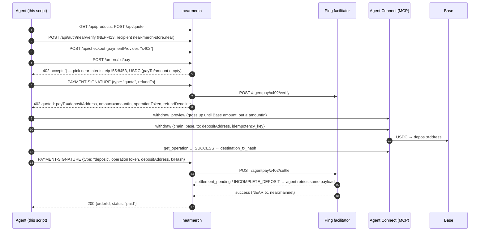

# nearmerch-agent-pay — an agent buys merch with Agent Connect + Ping Agent Pay

An agent buys a t-shirt from [nearmerch.com](https://nearmerch.com) and pays over **x402
`exact` + `near-intents`** ([x402 #3370](https://github.com/x402-foundation/x402/pull/3370)):

- **nearmerch** is the merchant: catalog, quote, Sign in with NEAR, x402 checkout, `POST /orders/:id/pay`
- **Ping Agent Pay** is the facilitator behind the store's pay route: mints a 1Click quote (a fresh
  Base deposit address) and settles to the store's NEAR recipient (`nearmerchstore.sputnik-dao.near`)
- **Agent Connect** is the payer wallet over MCP: withdraws NEAR Intents USDC to that deposit
  address on Base, under the owner's policy

Follows Ping's [Pay with Agent Connect](https://pingpay.gitbook.io/docs/pingpay-api/agent-pay-facilitator/pay-with-agent-connect)
guide (target v2 quote → deposit flow, not legacy `/prepare`); the MCP client and gross-up are
ported from Ping's [`examples/agent-connect-pay`](https://github.com/Pingpayio/ping-checkout-example/tree/main/examples/agent-connect-pay).

> **⚠ `pay` is mainnet, real money.** There is no NEAR Intents testnet. `pay` creates a real
> order (fulfilled by Printful once paid) and withdraws real USDC from your Agent Connect account.
> It refuses without `--confirm`, and refuses any quote, order or withdraw above `MAX_USDC`.
> x402 is switched off on nearmerch.com for now, so `NEARMERCH_URL` defaults to a local store.

## The flow



The agent never holds Ping's API key: the store calls Ping. The agent only needs its Agent
Connect key, a NEAR login for checkout, and a Base refund address.

## Quickstart

```sh
npm install
cp .env.example .env     # fill AGENT_CONNECT_KEY, REFUND_ADDRESS, NEAR_*, SHIP_*
npm run check            # read-only: catalog, pay route, Ping discovery, wallet + policy
npm run check -- <orderId>   # also decode the 402 of an existing payment_pending order
npm run pay -- --confirm # ⚠ real order + real USDC
npm test                 # offline: fake store + fake Ping + fake Agent Connect
```

Before `pay`:

- **Store**: a nearmerch build with the x402 intents integration, `X402_ENABLED=true`,
  `X402_INTENTS_ENABLED=true` and a `PING_API_KEY` for an org with Agent Pay on and a NEAR recipient set.
- **Agent Connect**: an account funded with USDC on NEAR Intents; policy with `withdraw` allowed,
  `destinations.mode: "any"` (every order gets a fresh deposit address) and `timelock_ms: 0` for an
  unattended run. `npm run check` prints the policy.
- **Amount**: Ping's 1Click route needs ≥ ~0.2 USDC; merch orders are far above that.

## Environment

| Variable | Required | Purpose |
|---|---|---|
| `NEARMERCH_URL` | – | Store base URL. Default `http://localhost:3000` |
| `PING_URL` | – | Ping host for public `/agentpay/x402/supported` in `check`. Default `https://pay.pingpay.io` |
| `AGENT_CONNECT_KEY` | pay | Agent Connect API key (Bearer, 30 days) |
| `AGENT_CONNECT_MCP_URL` | – | Default hosted `…/mcp` |
| `AGENT_CONNECT_ACCOUNT` | – | Account name from `get_accounts` (default: first enabled) |
| `NEAR_USDC_WITHDRAW_TOKEN` | – | Intents asset withdrawn to Base. Default NEAR USDC `nep141:17208628…133a1` |
| `REFUND_ADDRESS` | pay | Base address you control, sent as `refundTo` on the quote (no fallback) |
| `NEARMERCH_SIGNER` | – | `key` (default) or `agent-connect` (MCP `near_sign_message`, experimental) |
| `NEAR_ACCOUNT_ID` / `NEAR_PRIVATE_KEY` | pay (`key`) | Full-access key that signs the NEP-413 login |
| `PRODUCT_ID` / `VARIANT_ID` / `PRODUCT_QUERY` | – | What to buy. Default: cheapest ungated item |
| `QUANTITY` | – | Default 1 |
| `SHIP_FIRST_NAME` … `SHIP_COUNTRY` | pay | Shipping address (`SHIP_LINE2`, `SHIP_STATE`, `SHIP_PHONE` optional) |
| `MAX_USDC` | – | Hard cap on quote, order total, amountIn and withdraw. Default 40 |
| `MAX_PREVIEWS` | – | `withdraw_preview` calls for the gross-up (each counts toward custody quota). Default 3 |

## Safety

- `pay` stops before any request without `--confirm`; `check` creates, signs and moves nothing.
- `MAX_USDC` is checked against the quote (before sign-in), the order total, Ping's `amountIn` and
  the grossed-up withdraw; balance and policy are checked before checkout and at preview.
- One withdraw per order: the idempotency key is `nearmerch:<orderId>:<depositAddress>`, so a
  re-run replays the same operation instead of paying twice (changed params are refused).
- `settlement_pending` / `INCOMPLETE_DEPOSIT` retry the **same** deposit payload; a terminal error
  stops without retrying. Each irreversible step is journaled to `.state/last-run.json`.
- Keys are read from env only and never logged (tests assert it).

## Structure

```
src/
  nearmerch.ts      store client: products, quote, NEP-413 sign-in, checkout, pay route, pickItem
  ping-x402.ts      402 → near-intents entry → quote → deposit; settle retry classification
  agent-connect.ts  MCP client, accounts/balances, gross-up preview, withdraw, poll, near_sign_message wallet
  buy.ts            the whole purchase as one function (recipe + tests)
  x402.ts           x402 v2 types + base64 header codec    config.ts — env, constants, money helpers
scripts/01_check.ts read-only check
recipes/01_buy_with_agent_connect.ts   pay --confirm
tests/              vitest, offline: fakes for nearmerch (#258 behaviour), Ping, Agent Connect, Base
```

## Not verified live yet

- An end-to-end mainnet run: needs a funded Agent Connect key and a store with x402 intents on.
- The store side: nearmerch's pay route speaks this flow in
  [NEARBuilders/nearmerch.com#258](https://github.com/NEARBuilders/nearmerch.com/pull/258)
  (being moved onto Ping); nearmerch.com currently answers 404 on the pay route.
- `near_sign_message` argument and response field names (not in the public docs), and whether
  nearmerch's full-access-key check accepts the agent's NEAR key. Use `NEARMERCH_SIGNER=key` until then.
